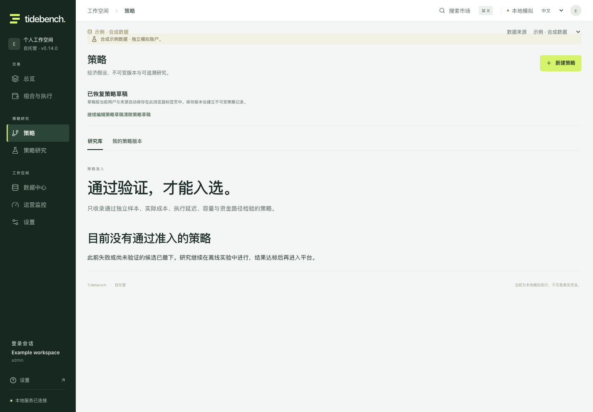

# Alpha 准入收紧与进一步市场挖掘

2026-10-11。本轮尚未找到达到要求的最终 Alpha 策略。平台撤下此前失败或未经验证的 16 个研究档案、7 个单市场预设和 8 个组合预设，准入名单为空。历史实验保留在离线档案中，供复现与防止重复试错；用户自行建立的定义和手工研究仍然可用。

这次调整涉及平台的预设与研究库展示。`examples/strategy-admission.json` 是明确的准入名单，不能替代服务端版本审批、账户风险控制或实盘收益验证。后续入选需要独立样本、原生执行成本、延迟、容量、资金路径和可复现证据；不会用假设数量代替通过验证的策略数量。

## 挖掘的对象与目前的结果

本轮围绕可以观察的成交、持仓、报价与现金约束建立规则。有关顶尖交易机构的材料只能帮助提出机制；没有证据证明本项目获得了 Citadel 或其他机构的内部策略。我们需要检验是谁在什么约束下承担成本、这种约束是否产生可重复的净收益，以及公开变量是否提供超过普通价格信息的增量。

| 实验 | 新实现的内容 | 实际评分 | 结论 |
|---|---|---:|---|
| 独立持仓创新 | 从头部持仓比例变化中剥离头部账户数、全市场账户数变化，检验确认、受挫、去杠杆后的恢复 | 24 个规格，120 个情景 | 无合格候选 |
| 现金与杠杆成交压力 | 使用成交金额，剥离现货与永续共同压力，拟合历史价格响应，检验现金支持与杠杆方向受挫 | 44 个规格、284 个情景，含消融 | 有正收益开发期线索，但未通过增量、集中度与多重检验 |
| OKX 原生吸收试验 | 逐笔成交、同价补单、实际买卖报价、最小合约数量、延迟与费用 | 单日 36 个情景 | 十分钟释放版本基础费用下略正，仅三笔；压力费用下为负 |
| OKX 固定日历反证 | 原价位退出最优报价后的释放，与普通突破、移除吸收、移除薄盘口条件对比 | 七日完整日历，336 个情景 | 四个完整规则版本均为负，没有增量优势 |
| 未观察的 2026 年压力反证 | 固定四个相邻完整规则，与去掉 OI、去掉接受条件及价格反转对照比较 | 16 项政策，48 个情景 | 四个完整版本全部亏损，旧最强线索降级 |

这些数字是相关实验的计数，不能当成独立样本数量，也不能换算为发现 Alpha 的概率。旧开发期已经被反复观察，按时间滚动拟合并不能消除研究者选择偏差。

## 两条线索为什么没有入选

独立持仓创新采用过去 90 个日历日、至少 60 个历史观测估计比例变化的残差，排除当前与前一日。它降低了账户分母效应的误读，但并没有把残差变成真实新增资本，也没有产生通过全部检验的策略。[全部结果](audit/capital-innovation-2026-10-11.json)和[冻结复现](audit/capital-innovation-verification-2026-10-11.json)保留 120 份账本的身份校验。

六小时成交压力使用 `2 × 主动买入成交金额 − 总成交金额`。这是已执行的方向压力；每笔成交仍有买卖双方，不能称为资金净流入。用此前 60 日的六小时区块拟合现货压力、永续压力、BTC 收益与标的收益；拟合期在形成及确认区块之前结束。现金压力需要在两段历史中均呈正的价格响应，交易采用此前估计的 BTC 对冲比率。

“杠杆方向受挫”要求永续成交压力异常、实际压力同向、OI 增长、价格未接受这种压力，并有反向独立现货压力。开发期最强的 `z=1.5 / 336小时` 版本在每次成交 10 bps 费用及 5 bps 滑点情景下得到 **26.2658%** 模拟账户收益，但只有 38 笔交易；按原交易数量归因，最好五笔贡献 **24.7321 个百分点**。它有 31 笔多头、7 笔空头，共同日历多重检验的日均收益下界仍为负。去掉 OI 条件的版本甚至更好，不能证明 OI 描述的机制增加了价值。

这是值得继续反证的线索，不能作为平台上的有效策略。交易归因中删除最好五笔的数字不是重新运行账户、重新复利后的收益。[完整开发期证据](audit/flow-pressure-2026-10-11.json)及[284 份账本的冻结复现](audit/flow-pressure-verification-2026-10-11.json)保留全部对照。

## 从公开市场档案推进到原生盘口

此前将历史盘口视为必须依赖付费权限的假设过于宽泛。实际调用证明，OKX 的匿名公开历史接口可以返回 400 档盘口和成交下载文件。[官方历史接口](https://www.okx.com/docs-v5/en/#public-data-rest-api-get-historical-market-data)规定盘口文件按 UTC 日、成交文件按 UTC+8 日聚合，因此一个 UTC 盘口日要配两个成交文件。

单日试验选择 SOL 是因为流动性和文件规模，不是选择旧实验中收益最强的 ADA。随后在请求档案前固定七个日期：7 月 1/15 日、8 月 1/15 日、9 月 1/15/29 日。七日捕获完成 42 个档案，约 **1.475 GB**，重建 **45,771,660** 条盘口记录；两个 UTC+8 成交文件的总记录数为 **15,882,961**，其中包含 UTC 日之外的部分，不能全部算作策略观测。单日工程样本另有约 246 MB 档案。

吸收定义为：30 秒内主动成交方向不平衡至少 0.6，反方向最优报价在两个端点价格相同，该价格上的普通成交至少达到初始挂量三倍，估计净补单至少达到初始挂量两倍。估计补单为 `期末挂量 − 期初挂量 + 同价成交量`，它不能识别隐藏流动性、挂单者或撤单路径。

释放规则进一步要求下一窗口继续同向成交、反方向最优报价沿交易方向移动、下一档最优报价挂量低于原挂量的四分之一、现货价格与成交压力确认。新最优档的挂量不等于原“墙”还剩多少；原价位不再是最优报价，也不能区分成交耗尽与撤单。

七日完整规则在每次成交 10 bps 费用、1 秒延迟下的结果如下。进出分别使用真实报价的买卖侧，价差已通过成交价支付；每笔只交易当前规则下的一个最小合约数量 0.01 SOL，没有假定被动成交或将结果放大成机构容量。

| 持有期 | 完成交易 | 平均每笔净收益 | 压力情景盈利日期 |
|---|---:|---:|---:|
| 2 分钟 | 10 | −25.2553 bps | 0 |
| 10 分钟 | 9 | −28.4470 bps | 0 |
| 30 分钟 | 8 | −34.2743 bps | 0 |
| 60 分钟 | 8 | −23.3429 bps | 2 |

完整规则没有超过全部消融对照；五秒延迟也没有挽救净收益。[全部 336 个情景](audit/okx-release-calendar-2026-10-11.json)与[文件和账本校验](audit/okx-release-calendar-verification-2026-10-11.json)保留每一天，没有替换不利日期。这七天是在观察较晚的 10 月 7 日样本后提出的历史反证，并非前瞻验证。

公开档案没有序列号、盘口校验字段及历史接收时钟。时间递增、定期快照、文件哈希和成交 CSV 的 CRC 校验能检验重建，却不能证明全部增量都没有丢失，更不能证明自己的订单队列位置。遇到未能退出的已入场头寸，完整盈亏评分失效。当前合约规则、声明费用及八小时不跨界约束也不等于已验证的历史账户条款。

另一个需要避免的误读是 `source=1`。它标记 ELP／RPI 类型的成交，不是机构身份。OKX 曾为这种流动性设置特定匹配和速度延迟，普通盘口也不包含它；本轮吸收量只使用 `source=0`，与普通盘口口径匹配。不能把这种标签直接称作“做市商库存”或把无法取得的报价计为自己的成交。[官方匹配规则调整](https://www.okx.com/en-gb/help/okx-to-adjust-elp-taker-eligibility)和[更名及盘口接口变更](https://www.okx.com/docs-v5/log_en/)是机制证据，不是盈利证据。

## 2026 年未观察时期的固定规则反证

旧开发期的“杠杆方向受挫”有正收益线索，因此另行声明了 2026 年实验：1 月至 9 月数据，前 60 日作为滚动拟合初始化，3 月 8 日至 9 月 30 日评分。固定两个阈值、两个相邻持有期、完整规则、去掉 OI、去掉价格接受条件、普通 BTC 相对价格反转对照，共 16 项政策、48 个费用／延迟情景。规则和实现均在请求这些档案前封存，2025 年原留出期不请求、不载入。

2,472 个官方档案全部通过校验，总计约 31.4 MB；解析没有无效观测，完整规则也没有因执行／资金费覆盖缺失而剔除交易。相同的压力费用下，结果如下：

| 固定版本 | 完成交易 | 新时期账户净收益 | 再延迟两小时 |
|---|---:|---:|---:|
| z=1.5，168 小时 | 15 | −2.5363% | −2.5131% |
| z=1.5，336 小时 | 12 | −2.6058% | −2.6178% |
| z=2，168 小时 | 8 | −2.0956% | −1.8674% |
| z=2，336 小时 | 6 | −1.9529% | −1.7125% |

四个完整规则在基础费用下也全部为负，多重检验下界全部为负。最强旧开发期版本从 +26.2658% 变成 −2.6058%，不再保留为优先 Alpha 线索。普通价格反转对照有一个正收益规格，但它不是新的机制证据，不能把这段结果重新挑成平台策略。所有结果见[48 个新时期情景](audit/pressure-unseen-2026-10-11.json)及[核验记录](audit/pressure-unseen-verification-2026-10-11.json)。

该研究是对适应性开发线索的独立时期反证，不会通过重新命名绕过原留出期的选择门槛，也没有在新数据上挑选胜者。它以此前拟合的 BTC 对冲、共同初始现金预算及交易时固定的合约单位记录价格盈亏、资金费和费用；这些百分比不是年化收益，亦未验证小时内原生保证金偿付。未知的 OKX 原生信号复制、容量、历史发布时间和资金路径仍是准入阻碍。

## 可复现的实现与准入边界

实现位于 `backend/tidebench/capital_innovation.py`、`flow_pressure.py`、`microstructure_research.py`，对应 `scripts/evaluate_*.py`。固定规则在 `examples/research/`，原始档案、冻结实现、压缩输入和逐笔账本在本机 `data/research/`；大型数据目录不会混入 Git。结果 JSON 和校验记录存于 `docs/audit/`。冻结重算使用归档实现，不能用之后修改的代码冒充原研究身份。

五组新实验合计 824 个情景，其冻结重算报告与首次运行逐字节一致。本轮相关 Python 测试 128 项通过，Ruff 检查通过，前端构建及撤下预设、手工配对模型、手工风险组合等相关桌面／移动工作流检查通过。[核验范围与实现身份](audit/alpha-discovery-verification-2026-10-11.json)保留具体范围。测试证明相应实现行为，不证明投资优势。

归档盘口实验的全部退出均可评分。随后进一步补全退出失败分支：先检查入场是否实际可执行，再检查未来退出；已入场但不能退出的头寸明确记录入场价格、数量、费用及计划退出时间，完整盈亏保持未知。这是账本记录的修正，未覆盖或重新标记原实验的冻结实现及结果。

目前的淘汰结论只针对声明的这些版本和样本，不能证明整个策略类别永远失效。也不能用“还缺一些数据”替代已经可以完成的公开数据实验。平台当前的合格 Alpha 数为 **0**，这比将正收益片段、机构故事或工程实现列为有效策略更准确。
