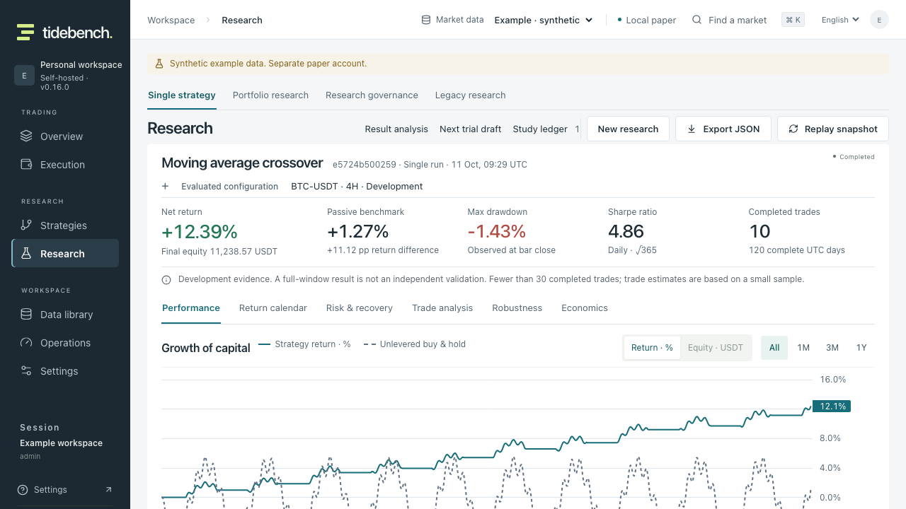
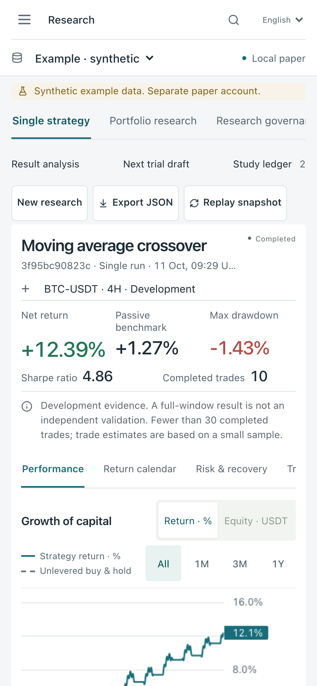

# 交易工作台界面审查 · v0.16.0

这轮解决的是任务界面的层级、密度与响应式行为。通过验收可以证明所列工作流可用；不能据此宣称产品已经达到某家买方机构的完整需求或证明策略盈利。

## 观察与判断

在升级前的实际部署中，1280×720、零滚动、既有 OKX 永续研究结果的主曲线起点为 y=842.54。首屏先后显示来源行、工作区分类、通用标题、文档导航、结果身份、配置、指标、说明与分析分类。问题是工作内容出现过晚。旧版在 721–1320px 把订单票据移到账簿末尾，操作与监控失去共同上下文。

独立 fresh-mind 审查按真实交易员的路径检查账户、订单、研究结果和策略假设，并挑战仅改颜色或增加面板的方案。采用一个共享分析工作台：导航退后，对象身份与金融记录优先，说明按必要性分层。

## 研究依据与适用边界

- [Linear 2026 界面更新](https://linear.app/now/behind-the-latest-design-refresh)描述保持高信息密度、减弱非任务元素、统一操作位置和减少不必要分隔的原则。这里借鉴其层级原则；交易数据与风险条件有自己的优先级。
- [TradingView 官方主题文档](https://www.tradingview.com/charting-library-docs/latest/customization/styles/custom-themes/)把工具栏、网格、坐标轴与图表作为同一套视觉系统。Tidebench 使用 Lightweight Charts；没有引入其 Advanced Charts 接口。
- [WCAG 2.2 非文本对比与目标大小](https://www.w3.org/TR/WCAG22/)用于区分视觉美化与可访问性要求。本轮只验证明确列出的对比、键盘和触控路径，不宣称全站 WCAG 合规认证。

## 已实施

1. 全站共享纸白／冷灰工作面、深灰蓝导航、青色操作与选择色；红绿保留盈亏及状态含义。颜色来自集中变量；Canvas 读取同一组变量，基准曲线仍有虚线区分。品牌柠檬色保留在标识。
2. 行情来源进入全局工具栏，与服务器返回的执行模式分别命名。合成来源及独立模拟账户提示保留。运维仍明确覆盖全部来源，策略库公开 OKX 检验仍有独立来源说明。
3. 研究文档导航与操作合并。所选结果的名称、身份和配置更紧凑；完成状态为中性处理状态。已评估配置与下一次草稿仍是不同对象。
4. 图表标题、图例、收益／权益选择和时间范围在统一工具栏中；观测读数移到主图下方，保留键盘检查和联动回撤。窄屏较长的摘要口径进入原生展开说明，完整指标与原因仍可访问。
5. 1180px 及以上，310px 订单票据与账簿并排，票据独立滚动。1180–1320px 永续账簿把标记价移入真实记录明细；数量、强平估计、精确盈亏和操作保持在主表。1179px 及以下恢复堆叠。
6. 策略假设库减少介绍高度，将“使用此假设”放到所选假设标题旁。机制、失效、淘汰条件、检验和原始来源仍完整保留。
7. 横向分类切换会把所选分类滚入其自身可见范围，不滚动整份文档；保持方向键、Home／End 操作。

## 独立审查后的修正

第二轮审查发现窄屏摘要说明仅存在于绩效分类，切换到其他分析时隐藏的完整口径失去入口。已把原生展开说明移到所有分类共享的位置，逐个检查六个分类的期末权益、收益差额、回撤观察、夏普口径与完整 UTC 日。截图导出分支移除测试留下的键盘焦点，运行时焦点提示保留。

## 可重复验收

- `backtest-analysis.spec.ts` 的首屏用例使用真实后端生成的明确合成数据。在零滚动 1280×720 中要求主图至少有 200px 可见；390×844 中至少 120px。它同时检查开发证据与合成提示、文档无水平溢出、键盘切换后分类可见，以及手机六个分析分类中的完整摘要口径。
- `execution-layout.spec.ts` 检查 1180／1280px 的现货与永续并排几何、所有主表数值不被操作列遮挡、强平与盈亏精度、标记价明细及 1179px 恢复。没有交易写入。
- `visual-desk.spec.ts` 检查中英文全局来源和执行模式、来源切换、44px 移动触控目标、已选导航文字至少 4.5:1 的对比、无水平溢出和无写入。
- 既有市场检查、订单草稿、收据、来源／会话隔离、回测六视图、不可变结果及治理工作流继续执行回归。

较长的策略名称、版本／封存标识和异常状态可能增加高度；首屏数值目标属于所列固定验收场景。历史金融结果与交易模型没有因为视觉升级而重算或改变。
